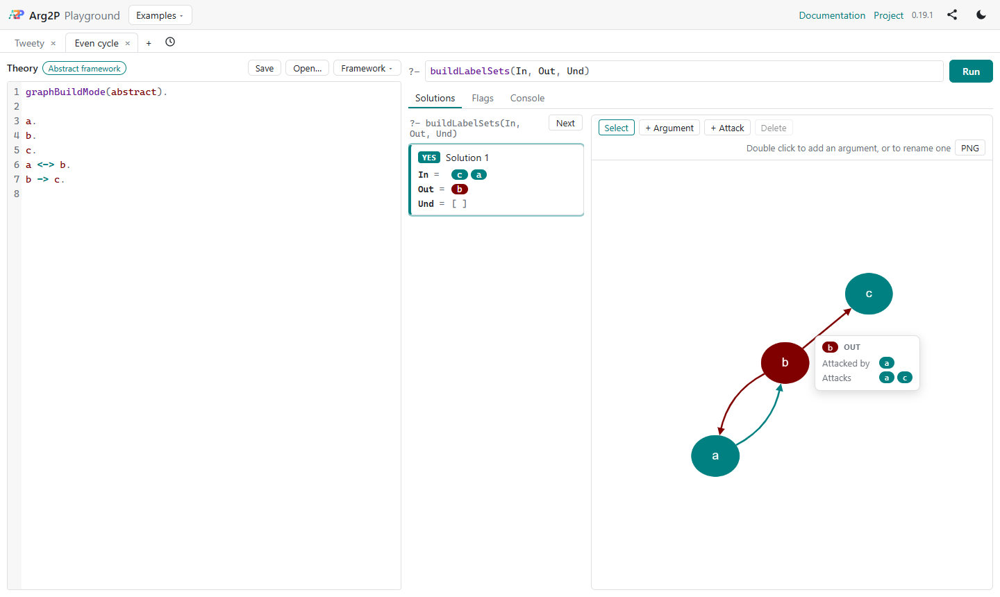
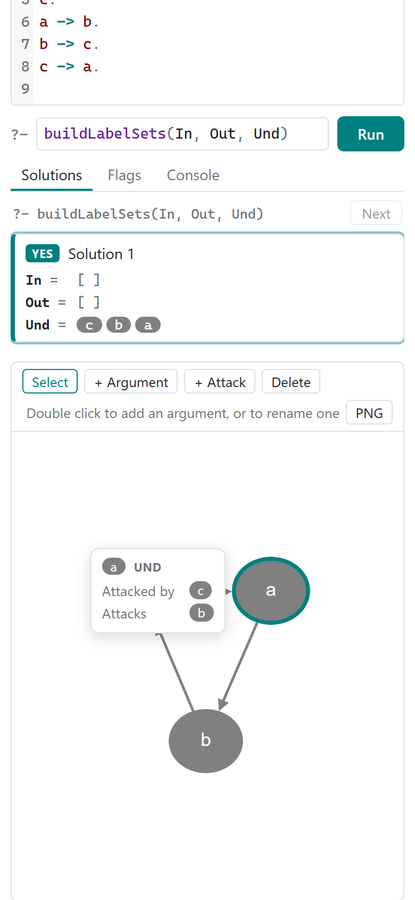

<p align="center"></p>

# [Arg2P-Kt](https://github.com/tuProlog/arg2p-kt) Web Playground

Try it at <https://tuprolog.github.io/arg2p-kt-web/>. The playground can be
installed as an app (*Install app* in Chrome and Edge, *Add to Home Screen* on
iOS) and then works offline, on desktops, tablets and phones.


## Packages

- [`packages/ui`](packages/ui): `@tuprolog/arg2p-ui`, the user interface of
  Arg2P as web components (the argument graph, the solutions, the drawing of
  abstract frameworks), on any engine: the solver of the browser
  (`@tuprolog/arg2p-ui/js`), or one of the JVM.
- [`packages/playground`](packages/playground): the playground, the page
  published on GitHub Pages.

## Install
```bash
  npm install
```

## Usage

- Start the dev server of the playground, or the page the components are tried on

```bash
  npm start -w @tuprolog/arg2p-playground
  npm run dev -w @tuprolog/arg2p-ui
```

- Run the tests of every package

```bash
  npm test
```

- Build every package (the playground in `packages/playground/dist`)

```bash
  npm run build
```

The playground is deployed to GitHub Pages by the CI, from `master`, once its tests pass.

## Theories and profiles

A theory is read in a **profile** (see [Profiles](https://tuprolog.github.io/arg2p-kt/docs/profiles/)):
ASPIC<sup>+</sup> by default, or the one it states, as `graphBuildMode(aba).`, or the one picked
in the *Flags* tab, which shows the flags the profile presets and where each value comes from.

An abstract framework is a theory of the profile `abstract`: `a.` an argument, `a -> b.` an
attack, `a <-> b.` a mutual one, and Prolog clauses may derive them
(`X -> Y :- beats(X, Y).`). It is shown as its **drawing**, which writes what is drawn into the
theory and draws the theory as it is edited: the arguments are coloured with the labelling of the
solution shown, what the theory derives is drawn dashed, and an argument hovered or tapped tells
its label, what attacks it and what it attacks. Frameworks are imported from APX, TGF and
ICCMA'23 files as theories, and exported to APX and TGF.

<p>
  
  
</p>

## Parallel runs and the federation

*Parallel*, a switch next to the tabs of the solver, runs the query on the parallel solver: on the Web Workers of the
page (one less than the processors of the device, at most 4), and on those of the devices it is paired with, as the
[federation](https://tuprolog.github.io/arg2p-kt/docs/modules/parallel-solver/) of the parallel solver. A parallel run
answers what the solver of the page answers, a solution at a time with its graph, with no stages.

The *Federation* tab pairs the playground with that of another device on the same network, and tells the devices
paired, their workers, how they are linked, and what the last parallel run built and how long it took.

1. *Invite a device* shows a QR code (and its link, to copy or share): the other device scans it with its camera, or
   opens the link, and joins once asked (joining starts its workers, and connects to the device that invited).
2. The other device shows a short code: type it on the device that invited, and they pair.

The reply of the device that joins goes through a public relay, [ntfy.sh](https://ntfy.sh) unless another one is set
(*Relay*, at the end of the tab: a ntfy server of your own works too), sealed with a key that only the QR code carries:
the relay reads none of it, and the code tells which reply comes from the device in front of you. Should the relay be
out of reach, the device that joins shows its reply as a QR code and a link: scan it, paste it, or open it on the device
that invited.

A device runs the theories the others send it: pair only with devices you trust.

## Sharing a setup

*Share* builds a link to the theory, query and flags shown: it packs them in a single compressed
`s` parameter, and the link opens them in a tab of their own, and runs them. Links can also be
written by hand with the plain parameters below.

| Parameter | Meaning |
| --- | --- |
| `theory` | The theory |
| `query` | The query |
| `flags` | The flags, as Prolog facts |
| `arguments` | The arguments of an abstract framework, e.g. `a,b,c` |
| `attacks` | Its attacks as `attacker-attacked`, e.g. `a-b,b-c` |
| `mode` | `abstract` or `structured`, as in the links of the former playground: with `abstract`, the framework of `arguments` and `attacks` is opened rather than a `theory` |

Every value is percent-encoded. A framework given by `arguments` and `attacks` becomes a theory of
the profile `abstract`; arguments mentioned only in `attacks` are added, so
`?attacks=a-b,b-a` is enough to describe a two argument framework. The links of the former
playground (its abstract mode, and the flags of `standard_af`) keep working.

```
?arguments=a,b,c&attacks=a-b,b-a,b-c&flags=argumentLabellingMode(preferred).
```
