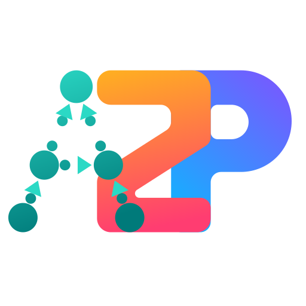
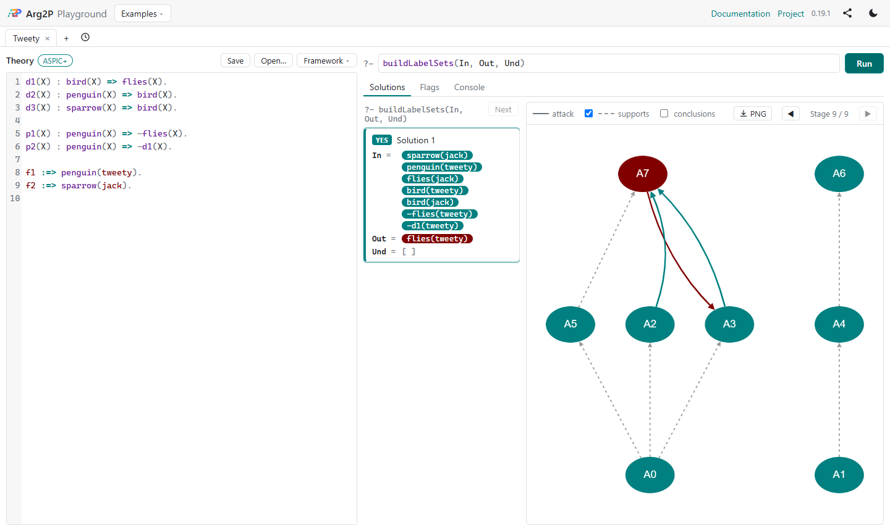
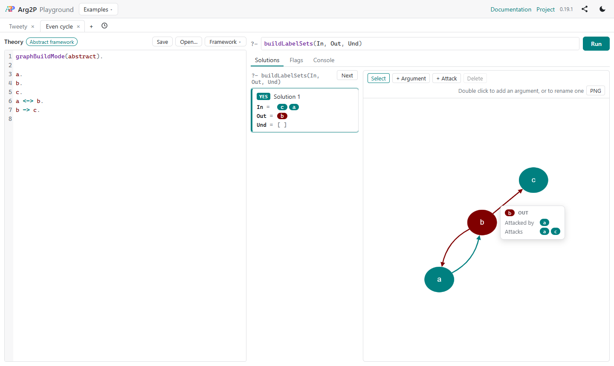
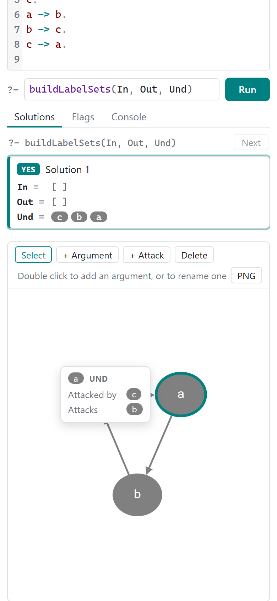

<p align="center"></p>

# [Arg2P-Kt](https://github.com/tuProlog/arg2p-kt) Web Playground

Try it at <https://tuprolog.github.io/arg2p-kt-web/>. The playground can be
installed as an app (*Install app* in Chrome and Edge, *Add to Home Screen* on
iOS) and then works offline, on desktops, tablets and phones.



## Packages

- [`packages/playground`](packages/playground): the playground, the page
  published on GitHub Pages.

It is built with `@tuprolog/arg2p-ui`, the user interface of Arg2P as web components (the argument graph, the
solutions, the drawing of abstract frameworks), which is developed and released with Arg2P itself, in
[tuProlog/arg2p-kt](https://github.com/tuProlog/arg2p-kt/tree/master/ui), at the same version.

## Install
```bash
  npm install
```

## Usage

- Start the dev server of the playground

```bash
  npm start -w @tuprolog/arg2p-playground
```

- Run the tests

```bash
  npm test
```

- Build every package (the playground in `packages/playground/dist`)

```bash
  npm run build
```

The playground is deployed to GitHub Pages by the CI, from `master`, once its tests pass.

## Theories and profiles

A theory is read in a **profile** (see [Profiles](https://tuprolog.github.io/arg2p-kt/docs/profiles/)):
ASPIC<sup>+</sup> by default, or the one it states, as `graphBuildMode(aba).`, or the one picked
in the *Flags* tab, which shows the flags the profile presets and where each value comes from.

An abstract framework is a theory of the profile `abstract`: `a.` an argument, `a -> b.` an
attack, `a <-> b.` a mutual one, and Prolog clauses may derive them
(`X -> Y :- beats(X, Y).`). It is shown as its **drawing**, which writes what is drawn into the
theory and draws the theory as it is edited: the arguments are coloured with the labelling of the
solution shown, what the theory derives is drawn dashed, and an argument hovered or tapped tells
its label, what attacks it and what it attacks. Frameworks are imported from APX, TGF and
ICCMA'23 files as theories, and exported to APX and TGF.

<p>
  
  
</p>

## Formalizing a text

*Text*, next to the theory, shows a text in natural language above it: *Formalize* has a language model write it as
a structured theory or an abstract framework (as picked), following the method of Arg2P (the skill `arg2p-formalize`),
checks it with the solver, and solves it. Each statement of the theory is linked to the passages of the text it comes
from: they share a colour, and the statement picked in the text, in the theory or in the graph stands out in all
three. What the model chose (its glossary, the readings of the ambiguous passages, its notes) is told under the text.

The model is one of [OpenRouter](https://openrouter.ai), `anthropic/claude-haiku-5.5` by default, with your own key (the
gear button): it is kept in your browser alone, and sent to OpenRouter alone, which charges the requests to it.

## Parallel runs and the federation

*Parallel*, a switch next to the tabs of the solver, runs the query on the parallel solver: on the Web Workers of the
page (one less than the processors of the device, at most 4), and on those of the federation of a server it is
connected to, as the [federation](https://tuprolog.github.io/arg2p-kt/docs/modules/parallel/#federation) of the
parallel solver. A parallel run answers what the solver of the page answers, a solution at a time with its graph, with
no stages.

The *Federation* tab connects the playground to a server of Arg2P: the extension of VS Code, or an instance on the JVM
or Node.js, listening. Type the address of its WebSockets and the code it shows (a page on https, as this one, reaches
`wss://` addresses alone, and `ws://localhost`), or open a link carrying them,
`https://tuprolog.github.io/arg2p-kt-web/#federate=wss%3A%2F%2Fhost%3A9432&code=1234`, and confirm. The devices of the
federation of the server lend each other their workers; the tab tells them, their workers, and what the last parallel
run built and how long it took. Browsers cannot link to one another: with no server, the playground solves on its own
Web Workers.

A device runs the theories the others send it: connect only to servers you trust.

## Sharing a setup

*Share* builds a link to the theory, query and flags shown (and the text they formalize, if any): it packs them in a single compressed
`s` parameter, and the link opens them in a tab of their own, and runs them. Links can also be
written by hand with the plain parameters below.

| Parameter | Meaning |
| --- | --- |
| `theory` | The theory |
| `query` | The query |
| `flags` | The flags, as Prolog facts |
| `arguments` | The arguments of an abstract framework, e.g. `a,b,c` |
| `attacks` | Its attacks as `attacker-attacked`, e.g. `a-b,b-c` |
| `mode` | `abstract` or `structured`, as in the links of the former playground: with `abstract`, the framework of `arguments` and `attacks` is opened rather than a `theory` |

Every value is percent-encoded. A framework given by `arguments` and `attacks` becomes a theory of
the profile `abstract`; arguments mentioned only in `attacks` are added, so
`?attacks=a-b,b-a` is enough to describe a two argument framework. The links of the former
playground (its abstract mode, and the flags of `standard_af`) keep working.

```
?arguments=a,b,c&attacks=a-b,b-a,b-c&flags=argumentLabellingMode(preferred).
```
