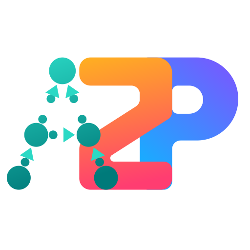

<p align="center"></p>

# [Arg2P-Kt](https://github.com/tuProlog/arg2p-kt) Web Playground

Try it at <https://tuprolog.github.io/arg2p-kt-web/>. The playground can be
installed as an app (*Install app* in Chrome and Edge, *Add to Home Screen* on
iOS) and then works offline.

## Install
```bash
  npm install
```

## Usage

- Start Webpack Dev server

```bash
  npm start
```

- Run mocha test

```bash
  npm test
```

- Build and create production ready artifacts in `prodDist` folder

```bash
  npm run build
```

- Deploy `prodDist` folder to Githun Pages

```bash
  npm run deploy
```

## Modes

The playground runs in one of two modes, selected from the toolbar:

- **Structured** — write an ASPIC<sup>+</sup> theory and run any query against it.
- **Abstract** — draw an abstract argumentation framework and evaluate it, the way
  ConArg does. Use the toolbar on the canvas to add arguments and attacks; the
  query is generated for you as `abstract::solve(Arguments, Attacks, In, Out, Und)`
  and the drawn graph is recoloured with the labelling of the solution currently
  shown. The semantics comes from the `argumentLabellingMode` flag, which the
  *Semantics* selector next to the query keeps in sync.

## Sharing a setup

The playground restores its state from the query string, so an example can be
handed over as a plain link. *Share* in the toolbar builds one from whatever is
currently loaded: it packs the whole state in a single compressed `s`
parameter. Links can also be written by hand with the plain parameters below,
which keep working.

| Parameter | Mode | Meaning |
| --- | --- | --- |
| `mode` | both | `structured` (default) or `abstract` |
| `flags` | both | Content of the *Flags* tab |
| `theory` | structured | Content of the *Theory* editor |
| `query` | structured | Content of the *Query* editor |
| `arguments` | abstract | Argument names, e.g. `a,b,c` |
| `attacks` | abstract | Attacks as `attacker-attacked`, e.g. `a-b,b-c` |

Every value is percent-encoded. Argument names have to be Prolog atoms; invalid
ones are dropped and reported. Arguments mentioned only in `attacks` are added to
the graph, so `?mode=abstract&attacks=a-b,b-a` is enough to describe a two
argument framework.

```
?mode=abstract&arguments=a,b,c&attacks=a-b,b-a,b-c&flags=argumentLabellingMode(preferred).
```
